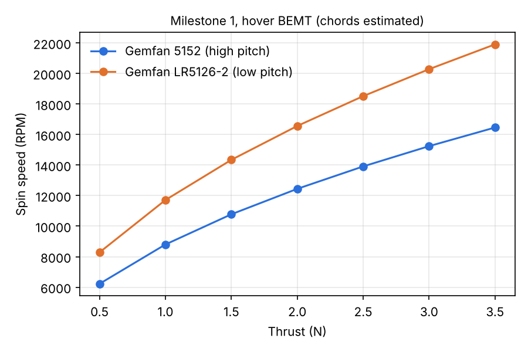
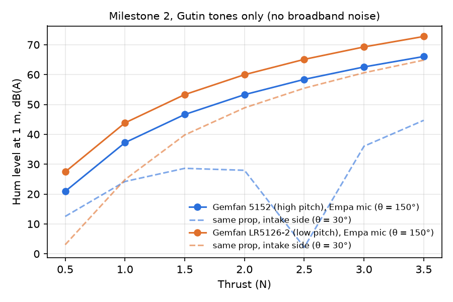

# Propeller Noise Simulator

How fast, how loud, and how annoying are small drone propellers?

This project rebuilds, in code, the conventional-propeller part of Empa's 2026
study ([Meister, Van Renterghem & Pieren, *Acta Acustica* 10, 57](https://doi.org/10.1051/aacus/2026057)),
then asks one question the paper leaves open: **is the loudest propeller also the
most annoying one?**

Built by Loonweewat Tan to understand the physics behind propellers. Plan: [`docs/PRD.md`](docs/PRD.md).

## Run it

```bash
pip install -r requirements.txt
python scripts/run_m1.py     # spin speed; results go to results/
python scripts/run_m2.py     # hum level in dB(A)
pytest                       # checks the physics and Empa's findings
```

On Google Colab: `!git clone <this repo URL>`, `%cd propeller-noise-sim`, then the
same commands with `!` in front.

## Results so far (Milestone 1)

| Thrust | 5152 (high pitch) | LR5126-2 (low pitch) |
|---|---|---|
| 0.5 N | 6,222 rpm, hum 207 Hz | 8,282 rpm, hum 276 Hz |
| 2.0 N | 12,445 rpm, hum 415 Hz | 16,563 rpm, hum 552 Hz |
| 3.5 N | 16,463 rpm, hum 549 Hz | 21,911 rpm, hum 730 Hz |
| Figure of merit | 0.61 | 0.68 |

Both of Empa's orderings come out of the model without tuning: the low-pitch
prop spins faster (so its hum is higher) and is more efficient.

**Caution:** blade widths are estimates, so absolute RPMs may be off by 10-20%.
The orderings are the trustworthy part until the real blades are measured.



## Results so far (Milestone 2: the hum)

Hum level at Empa's microphone: 1 m, 60° below the rotor plane on the
slipstream side (θ = 150° from the thrust direction; Empa, Section 3.2, Fig. 8).
Gutin tones m = 1..10, in dB(A):

| Thrust | 5152 (high pitch) | LR5126-2 (low pitch) | Gap |
|---|---|---|---|
| 0.5 N | 20.9 | 27.4 | +6.5 |
| 2.0 N | 53.3 | 60.0 | +6.7 |
| 3.5 N | 66.1 | 72.8 | +6.7 |

**Empa check passes without tuning:** the high-pitch 5152 is quieter at every
thrust, by 6.5 to 6.7 dB(A). Empa measured about 5 dB.

Which side of the propeller matters a lot. Below the rotor, in the slipstream,
the "push" (thrust) and "twist" (torque) parts of the hum add up. Above it, on
the intake side (θ = 30°), they work against each other. For the 5152 they
cancel almost perfectly near 2.5 N there, which is an artefact of putting all
blade force at one radius. The dashed lines in the chart show that side.

Why the low-pitch prop is louder: it must spin about 33% faster for the same
thrust. Hum strength grows very steeply with blade-tip speed (through the Bessel
term), and the faster hum also sits where ears are more sensitive, so A-weighting
cuts it less.



## Checkpoints: how to go back if something breaks

Every working version is saved as a git **commit**. Every finished milestone gets a
**tag** (a permanent bookmark). GitHub runs the tests on every push, so a red ✗
on GitHub means the latest change broke something.

```bash
git log --oneline            # list of saved versions
git tag                      # list of milestone bookmarks
git checkout v0.1-m1         # look at Milestone 1 exactly as it was
git checkout main            # come back to the latest version
git revert <commit-id>       # undo one bad change, keeping history
```

Rule of thumb: commit small and often, tag only when the tests pass.

## Roadmap

| Tag | Milestone |
|---|---|
| v0.1-m1 ✅ | Spin speed, hum frequency, power, efficiency |
| v0.2-m2 ✅ | Tonal noise level at 1 m, 60° below the rotor (Gutin model), dB(A) |
| v0.3-m3 | Blade-spacing study: 2 vs 4 even vs 4 uneven blades |
| v0.4-m4 | Sound files + loudness, sharpness, annoyance (ISO 532-1) |
| v0.5-m5 | Score Empa's real recordings, if shared |
| v0.6-m6 | Virtual rig (3D model + animated test) |

## Known limitations
See `CLAUDE.md`. The biggest one: only the tonal hum is modelled, not broadband
"hiss", which is where Empa found the toroidal propeller differs. Gutin also
puts all blade force at one radius (80%), which is why the intake-side
cancellation comes out unrealistically deep.
