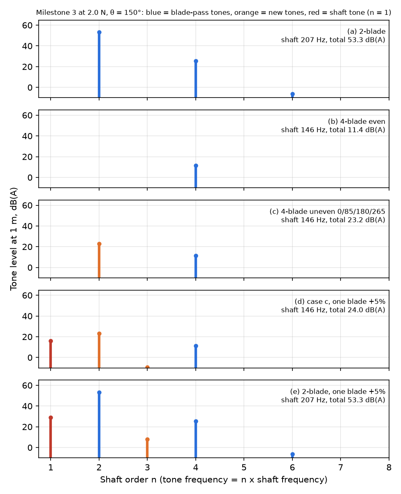
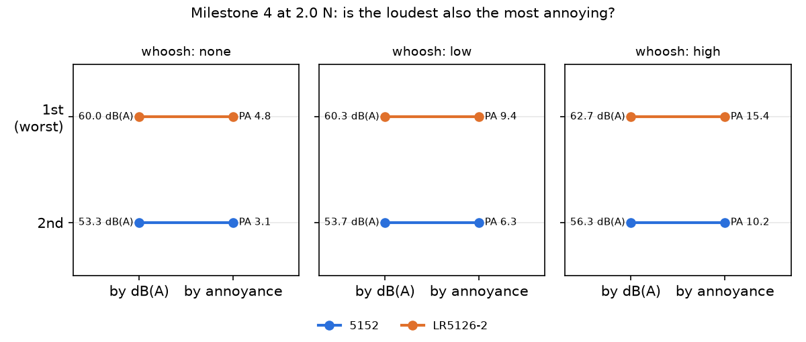
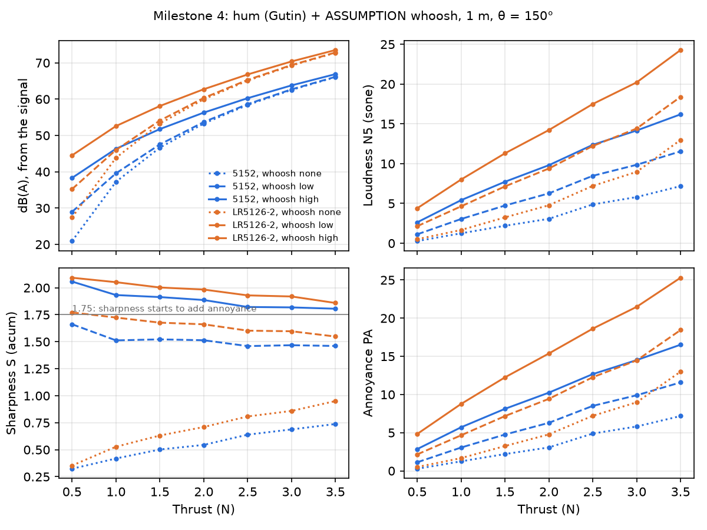

# Propeller Noise Simulator

**[▶ Open the Propeller Lab](https://kivoon-dev.github.io/Propeller-Noice-Sim/viz/propeller_lab.html)**: slide the thrust and watch, hear
and compare both propellers in your browser (Milestones 1 to 3).

How fast, how loud, and how annoying are small drone propellers?

This project rebuilds, in code, the conventional-propeller part of Empa's 2026
study ([Meister, Van Renterghem & Pieren, *Acta Acustica* 10, 57](https://doi.org/10.1051/aacus/2026057)),
then asks one question the paper leaves open: **is the loudest propeller also the
most annoying one?**

Built by Loonweewat Tan to understand the physics behind propellers. Plan: [`docs/PRD.md`](docs/PRD.md).

## Run it

```bash
pip install -r requirements.txt
python scripts/run_m1.py     # spin speed; results go to results/
python scripts/run_m2.py     # hum level in dB(A)
python scripts/run_m3.py     # blade spacing and uneven blades
python scripts/run_m4.py     # sound files + loudness and annoyance (about 3 min)
pytest                       # checks the physics and Empa's findings
```

On Google Colab: `!git clone <this repo URL>`, `%cd propeller-noise-sim`, then the
same commands with `!` in front.

## See it and hear it

The [Propeller Lab](https://kivoon-dev.github.io/Propeller-Noice-Sim/viz/propeller_lab.html) ([`viz/propeller_lab.html`](viz/propeller_lab.html))
has three stations: Spin (M1), Hum (M2) and Notes (M3, blade layouts and the
shaft tone). [`viz/hum_bench.html`](viz/hum_bench.html) is the older bench: drag the
thrust, watch both propellers spin with their downwash and sound reaching the
microphone, read the live numbers and charts, and press Listen to hear each
propeller's predicted hum. Download the file and open it in any web browser (it
works offline; fonts need internet but fall back to system fonts). It runs the same
model as the Python code, and `tests/test_viz.py` checks both pages' numbers still match.

## Results so far (Milestone 1)

| Thrust | 5152 (high pitch) | LR5126-2 (low pitch) |
|---|---|---|
| 0.5 N | 6,222 rpm, hum 207 Hz | 8,282 rpm, hum 276 Hz |
| 2.0 N | 12,445 rpm, hum 415 Hz | 16,563 rpm, hum 552 Hz |
| 3.5 N | 16,463 rpm, hum 549 Hz | 21,911 rpm, hum 730 Hz |
| Figure of merit | 0.61 | 0.68 |

Both of Empa's orderings come out of the model without tuning: the low-pitch
prop spins faster (so its hum is higher) and is more efficient.

**Caution:** blade widths are estimates, so absolute RPMs may be off by 10-20%.
The orderings are the trustworthy part until the real blades are measured.


## Results so far (Milestone 2: the hum)

Hum level at Empa's microphone: 1 m, 60° below the rotor plane on the
slipstream side (θ = 150° from the thrust direction; Empa, Section 3.2, Fig. 8).
Gutin tones m = 1..10, in dB(A):

| Thrust | 5152 (high pitch) | LR5126-2 (low pitch) | Gap |
|---|---|---|---|
| 0.5 N | 20.9 | 27.4 | +6.5 |
| 2.0 N | 53.3 | 60.0 | +6.7 |
| 3.5 N | 66.1 | 72.8 | +6.7 |

**Empa check passes without tuning:** the high-pitch 5152 is quieter at every
thrust, by 6.5 to 6.7 dB(A). Empa measured about 5 dB.

Which side of the propeller matters a lot. Below the rotor, in the slipstream,
the "push" (thrust) and "twist" (torque) parts of the hum add up. Above it, on
the intake side (θ = 30°), they work against each other. For the 5152 they
cancel almost perfectly near 2.5 N there, which is an artefact of putting all
blade force at one radius. The dashed lines in the chart show that side.

Why the low-pitch prop is louder: it must spin about 33% faster for the same
thrust. Hum strength grows very steeply with blade-tip speed (through the Bessel
term), and the faster hum also sits where ears are more sensitive, so A-weighting
cuts it less.


## Results so far (Milestone 3: blade spacing)

Empa found that the Donut (a 4-blade toroidal propeller) has its strongest tone
at the **shaft frequency**, once per turn. Normal propellers hum at the
blade-pass frequency instead. Milestone 3 asks what blade layout can cause that.

**The idea, in plain words.** Every blade on its own makes a tone once per turn
and at all multiples of that. When the blades are identical and evenly spaced,
most of those tones cancel between blades, and only the blade-pass hum is left.
Moving a blade, or letting one blade push a little harder, spoils the
cancelling and lets new tones through.

**The surprise.** Our guessed uneven layout (blades at 0°, 85°, 180°, 265°)
still looks the same after half a turn. Because of that, every "odd" tone
cancels, including the once-per-turn tone. The uneven spacing adds a new tone at
**twice** the shaft frequency, not at the shaft frequency. In the model, the
once-per-turn tone only appears when that half-turn symmetry is broken, for
example when one blade carries slightly more load than the others.

All cases at 2.0 N, 1 m, θ = 150°:

| Case | Total dB(A) | Once-per-turn tone (n = 1), dB(A) |
|---|---|---|
| (a) 2-blade | 53.3 | none |
| (b) 4-blade, even | 11.4 | none |
| (c) 4-blade, uneven 0/85/180/265 | 23.2 | none (new tone at n = 2: 22.9) |
| (d) case c, one blade +5% load | 24.0 | 16.0 |
| (e) 2-blade, one blade +5% load | 53.3 | 29.1 |

The once-per-turn tone grows by 6 dB each time the mismatch doubles. For the
uneven 4-blade it is 21 dB(A) below the loudest tone at 1% mismatch, 7 below at
5% and 1.3 below at 10%. For the 2-blade it stays 18 to 38 dB(A) below the hum.



**What this suggests (a hypothesis, not a result).** The model suggests the
Donut's shaft tone comes from **imperfection**, meaning blades that are not
quite alike, rather than from blade spacing alone. That holds if its spacing is
half-turn symmetric like ours; a layout without that symmetry would make a shaft
tone by itself. Even then, a mismatch of about 10% would be needed before the
shaft tone becomes the loudest, as Empa saw. This has to be checked on the real
rig (by weighing or measuring each blade) or with Empa's data.

**Cautions:** the 4-blade prop is a made-up 4-blade version of the 5152, not the
Donut. The uneven angles and the 5% mismatch are guesses. Gutin's model makes the
slow 4-blade rotor unrealistically quiet (about 11 dB(A)), because it leaves out
the unsteady and broadband noise that real rotors also make.

## Results so far (Milestone 4: listen and score)

**The question:** at the same thrust, is the loudest propeller also the most
annoying one?

**What we did, in plain words.** We turned the predicted hum into a sound file,
so you can listen to it, and then scored it the way people judge sound:
- **Loudness** (sone): how loud it seems; 2 sone sounds twice as loud as 1.
- **Sharpness** (acum): how hissy and high-pitched it is.
- **Roughness** (asper): a fast buzzing flutter.
- **Annoyance**: starts from loudness and goes up if the sound is sharp or rough.

Real propellers also make a rushing-air "whoosh" that our physics does not
predict. So we **guessed** it at three levels (none, low, high) and checked
whether the answer depends on the guess.

At 2.0 N, 1 m, θ = 150°:

| Whoosh | Prop | dB(A) | Loudness N5 (sone) | Sharpness (acum) | Annoyance PA |
|---|---|---|---|---|---|
| none | 5152 | 53.3 | 3.1 | 0.54 | 3.1 |
| none | LR5126-2 | 60.0 | 4.8 | 0.71 | 4.8 |
| low | 5152 | 53.7 | 6.3 | 1.51 | 6.3 |
| low | LR5126-2 | 60.3 | 9.4 | 1.66 | 9.4 |
| high | 5152 | 56.3 | 9.8 | 1.89 | 10.2 |
| high | LR5126-2 | 62.7 | 14.2 | 1.98 | 15.4 |

**Answer in this model: yes.** The low-pitch LR5126-2 is the loudest *and* the
most annoying at every whoosh level and every thrust. That supports the
hypothesis. The ranking did not flip, so the whoosh guess does not decide the
answer here.



**What else we learned:**
- **The hum alone is not sharp or rough.** Sharpness stays below 1.75 acum
  (where it starts to count) and roughness is about 0.001 asper. So annoyance
  equals loudness.
- **dB(A) under-counts the whoosh.** A whoosh 10 dB(A) quieter than the hum
  adds only 0.4 dB to the dB(A) reading, but it *doubles* the loudness (3.1 to
  6.3 sone). The ear adds up sounds in different pitch ranges more generously
  than a dB(A) meter does.
- **The once-per-turn note (Milestone 3) adds no roughness.** It is too far in
  pitch from the hum to beat against it. It does make the 2-blade 9% louder
  (3.07 to 3.35 sone) at the same dB(A).

**Be careful with this answer.** Our whoosh grows with blade-tip speed, and the
LR5126-2 spins faster, so the whoosh can only make it worse. By construction, it
cannot reverse the ranking. A whoosh with a different shape for each propeller,
which real blades could have, might still change the answer. Empa's recordings
(Milestone 5) or the real rig are needed to test that.

**Listen** (2 N, all on the same volume scale, so louder files really are louder):
5152 [no whoosh](results/audio/m4_5152_2N_whoosh-none.wav) ·
[low](results/audio/m4_5152_2N_whoosh-low.wav) ·
[high](results/audio/m4_5152_2N_whoosh-high.wav);
LR5126-2 [no whoosh](results/audio/m4_LR5126-2_2N_whoosh-none.wav) ·
[low](results/audio/m4_LR5126-2_2N_whoosh-low.wav) ·
[high](results/audio/m4_LR5126-2_2N_whoosh-high.wav).



## Checkpoints: how to go back if something breaks

Every working version is saved as a git **commit**. Every finished milestone gets a
**tag** (a permanent bookmark). GitHub runs the tests on every push, so a red ✗
on GitHub means the latest change broke something.

```bash
git log --oneline            # list of saved versions
git tag                      # list of milestone bookmarks
git checkout v0.1-m1         # look at Milestone 1 exactly as it was
git checkout main            # come back to the latest version
git revert <commit-id>       # undo one bad change, keeping history
```

Rule of thumb: commit small and often, tag only when the tests pass.

## Roadmap

| Tag | Milestone |
|---|---|
| v0.1-m1 ✅ | Spin speed, hum frequency, power, efficiency |
| v0.2-m2 ✅ | Tonal noise level at 1 m, 60° below the rotor (Gutin model), dB(A) |
| v0.3-m3 ✅ | Blade-spacing study: 2 vs 4 even vs 4 uneven blades |
| v0.4-m4 ✅ | Sound files + loudness, sharpness, annoyance (ISO 532-1) |
| v0.5-m5 | Score Empa's real recordings, if shared |
| v0.6-m6 | Virtual rig (3D model + animated test) |

## Known limitations
See `CLAUDE.md`. The biggest one: only the tonal hum is modelled, not broadband
"hiss", which is where Empa found the toroidal propeller differs. Gutin also
puts all blade force at one radius (80%), which is why the intake-side
cancellation comes out unrealistically deep.
